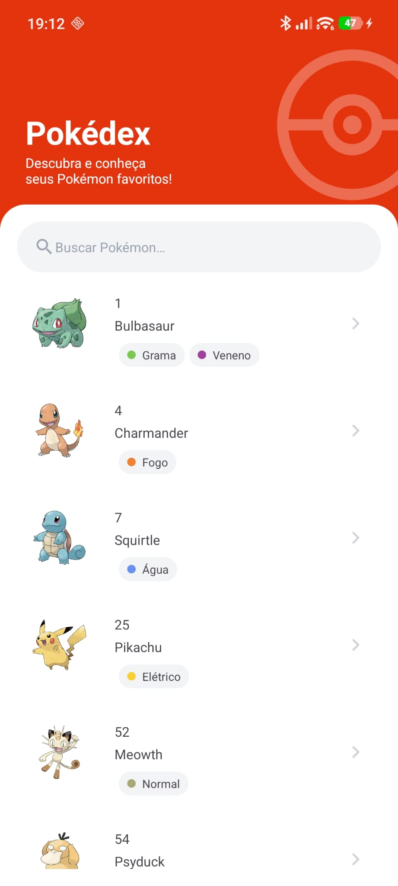
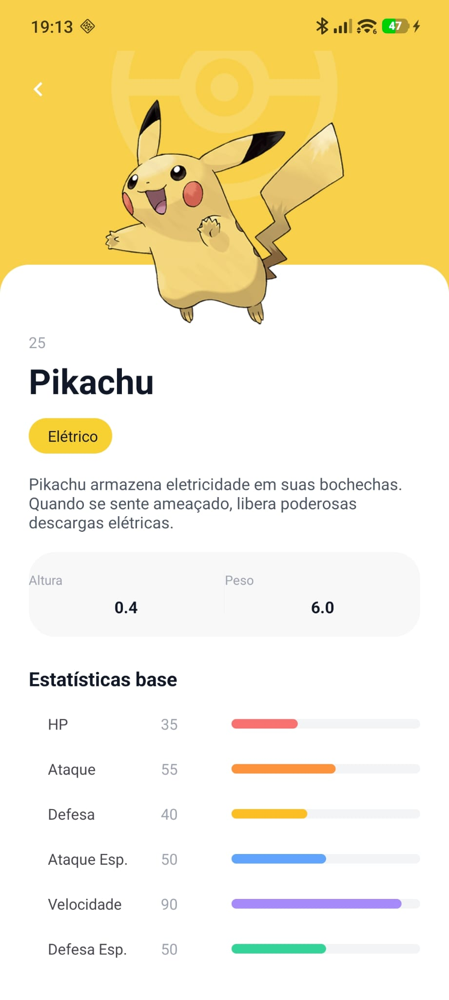
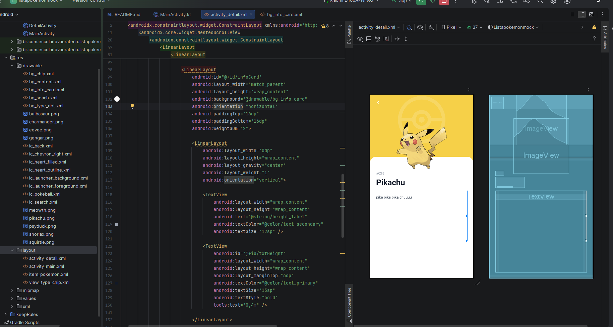

# Pokédex — Android com Kotlin

Aplicativo Android desenvolvido para praticar a criação de interfaces em XML, listas com RecyclerView e navegação entre telas utilizando Kotlin. Permite explorar uma lista de Pokémon, pesquisar pelo nome e consultar informações e estatísticas de cada personagem.

Os dados são locais e simulados (mock), fornecidos pela classe `PokemonMok`, sem consulta a uma API externa.

## Telas do aplicativo

| Lista de Pokémon | Pesquisa por nome | Detalhes e estatísticas |
| :---: | :---: | :---: |
|  |  |  |

## Funcionalidades

- **Listagem de Pokémon:** exibição de imagem, número, nome e tipos.
- **Pesquisa em tempo real:** filtragem conforme o usuário digita, sem diferenciar letras maiúsculas de minúsculas. Ao limpar o campo, a lista completa volta a aparecer.
- **Navegação para detalhes:** ao selecionar um Pokémon, seu identificador é enviado para a tela de detalhes.
- **Informações individuais:** imagem, nome, número, descrição, altura e peso.
- **Tipos com cores próprias:** etiquetas criadas dinamicamente para os tipos de cada Pokémon.
- **Personalização visual:** a cor de fundo da tela de detalhes acompanha o primeiro tipo do Pokémon.
- **Estatísticas base:** HP, ataque, defesa, ataque especial, velocidade e defesa especial, com valores e barras de progresso coloridas.
- **Botão de voltar:** retorno à tela anterior com `finish()`.

## Tecnologias e recursos utilizados

| Tecnologia ou recurso | Aplicação no projeto |
| --- | --- |
| Kotlin | Lógica do aplicativo, tratamento de eventos e manipulação de listas. |
| Android Studio | Desenvolvimento, visualização dos layouts e execução do app. |
| XML e Android Views | Construção das telas e dos componentes visuais. |
| AppCompatActivity | Implementação das telas `MainActivity` e `DetailActivity`. |
| RecyclerView e adapter personalizado | Apresentação da lista e envio dos itens com `submitList()`. |
| EditText e `doOnTextChanged` | Observação das alterações no campo de pesquisa. |
| `filter` e `contains(ignoreCase = true)` | Filtragem dos Pokémon pelo nome. |
| Intent e extras | Passagem do ID do Pokémon entre as telas. |
| `companion object` | Organização da chave do extra e da função `createIntent()`. |
| ConstraintLayout e LinearLayout | Posicionamento e organização dos elementos da interface. |
| NestedScrollView | Rolagem do conteúdo na tela de detalhes. |
| LayoutInflater | Criação das etiquetas de tipos e das linhas de estatísticas a partir de layouts XML. |
| TextView, ImageView e ProgressBar | Exibição de textos, imagens e estatísticas. |
| ContextCompat | Acesso a cores e drawables dos recursos do aplicativo. |
| LayerDrawable e `setTint()` | Personalização das cores das barras de progresso. |
| `mutate()` e `setTint()` | Alteração das cores dos fundos usados na tela de detalhes e nas etiquetas. |
| `enableEdgeToEdge` e WindowInsetsCompat | Uso da área da tela e ajuste de espaçamento para as barras do sistema. |
| Recursos em `res` | Organização de imagens, fundos, cores, textos e layouts. |

## Organização do projeto

- **MainActivity:** carrega a lista, conecta o adapter ao RecyclerView, aplica a pesquisa e abre os detalhes do Pokémon selecionado.
- **DetailActivity:** recebe o ID, procura o Pokémon com `PokemonMok.findById()` e preenche os componentes da tela.
- **adapter:** reúne o adapter responsável pela apresentação dos itens e pelo evento de clique.
- **data:** contém os dados locais em `PokemonMok`.
- **model:** reúne os modelos `PokemonModel` e `PokemonType`.
- **res/layout:** contém as telas e os layouts reutilizados, como `view_detail_type_chip` e `view_stat_row`.
- **res/drawable:** contém imagens e fundos personalizados, incluindo `bg_stat_progress`.
- **res/values:** organiza recursos como textos e cores.

## Como funciona

Na tela inicial, a lista de `PokemonMok.pokemons` é enviada ao adapter. O campo de pesquisa observa o texto digitado e envia uma nova lista filtrada para exibição.

Ao tocar em um item, `DetailActivity.createIntent()` cria uma Intent com o ID do Pokémon. A tela de detalhes recupera esse ID com `getIntExtra()` e consulta os dados locais.

Os tipos são adicionados ao `typeContainer` com `LayoutInflater` e `addView()`. As estatísticas são organizadas em uma lista de `Triple`, reunindo nome, valor e recurso de cor. Cada entrada gera uma linha com texto e uma barra de progresso personalizada.

## Como executar

1. Clone ou baixe este repositório.
2. Abra a pasta raiz do projeto no Android Studio.
3. Aguarde a sincronização do Gradle e instale os componentes do SDK solicitados pelo projeto.
4. Selecione um emulador ou conecte um dispositivo Android com a depuração USB ativada.
5. Execute o módulo `app` pelo botão **Run ▶**.

## Aprendizados

Este projeto faz parte dos meus estudos em desenvolvimento Android com Kotlin. Durante a implementação, pratiquei a integração entre Kotlin e XML, callbacks de clique, navegação com passagem de dados, filtragem de coleções, reutilização de layouts e personalização de componentes visuais.

Também utilizei funções lambda, `forEach`, `Triple`, `also` e verificações de valores nulos para organizar a lógica das telas.

## Registro do desenvolvimento

O print abaixo mostra uma etapa da montagem da tela de detalhes no editor de layouts do Android Studio. As capturas acima mostram o aplicativo em execução.

Pokémon e seus personagens pertencem aos respectivos titulares. Este é um projeto educacional, sem vínculo oficial com a franquia.
